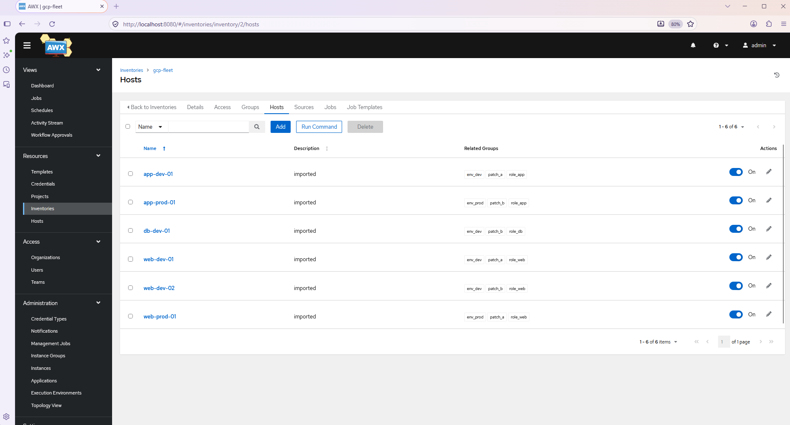
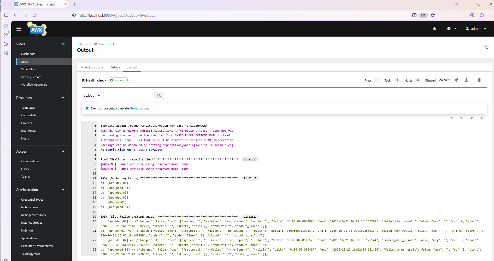
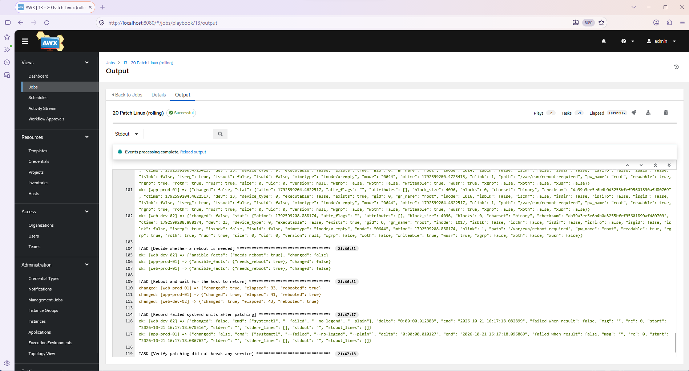
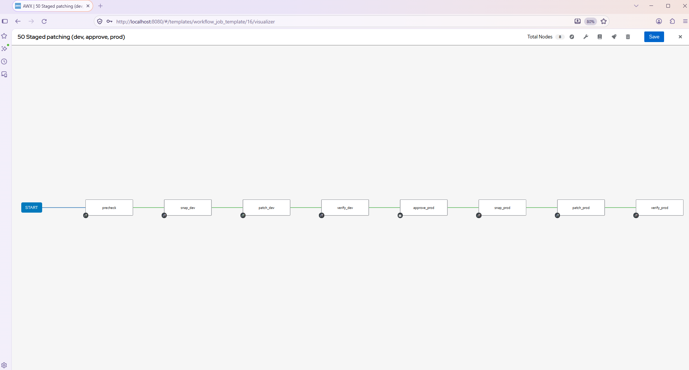
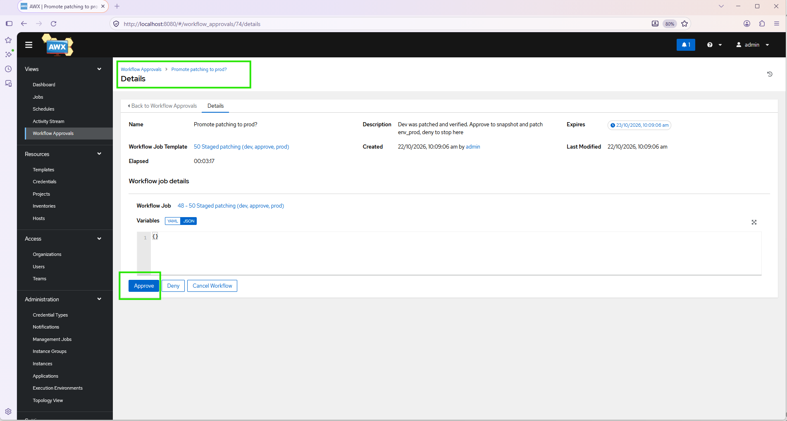
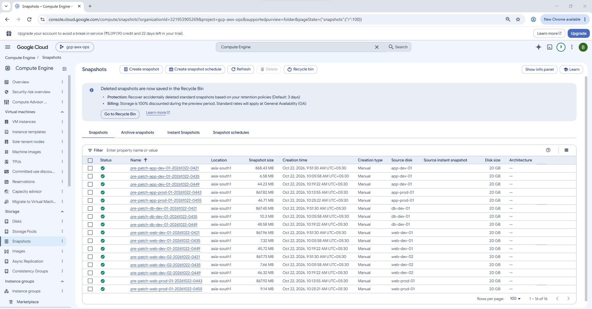
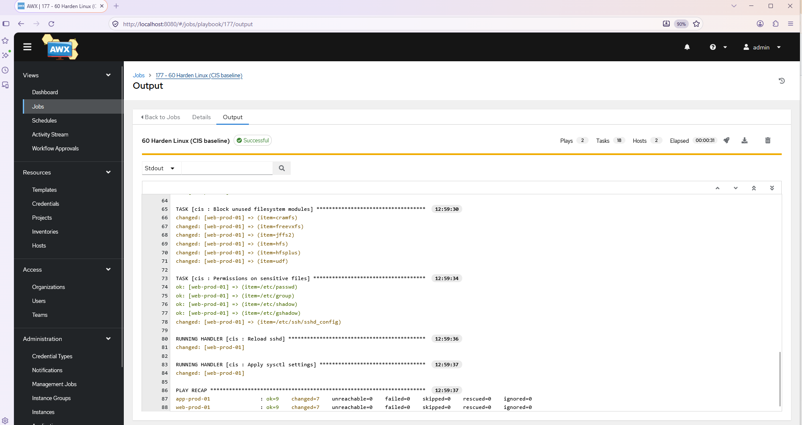
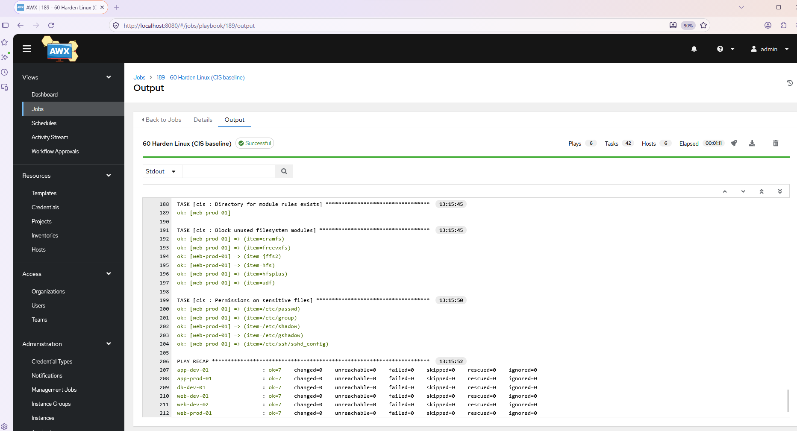

# Enterprise Day-2 Operations Automation Platform on GCP

Terraform provisions it. GitHub Actions delivers it. AWX (upstream of Ansible Tower / Automation Controller) runs the daily operations.

## Status

All phases are built and were run end to end on a real GCP project. 90 snapshots from the live run are in [docs/SNAPSHOTS.md](docs/SNAPSHOTS.md) and the highlights are [below](#snapshots).

What was proven on the running platform:

| Area | Result |
|---|---|
| Platform | Private GKE, Cloud SQL (private IP), AWX running, all from Terraform and GitHub Actions with no stored keys |
| Fleet | VMs grouped by labels; dynamic inventory with no service account key |
| Patching | Staged workflow: snapshot, patch dev, verify, approval, patch prod |
| Self-healing | A stopped VM is started again within seconds |
| Onboarding | A new VM is configured by AWX as soon as the audit log shows it was created |
| Hardening | Dry run, real run, then `changed=0` on a second run, dev and prod |
| Quality | ansible-lint and Molecule run on every change; custom execution environment built and pushed |
| Access | Separate look, operate and approve duties (RBAC) |
| HTTPS | Optional entry with a managed certificate, restricted to an allowlist |
| Alerts | A failed job and a succeeded job each send a chat message (Discord) with a working link |

## What this project is

Servers are easy to build and hard to operate. This project builds the platform that handles the daily operational work (patching, hardening, access, health checks, self-healing, cost control) as **self-service, scheduled, auditable and event-driven automation**.

| Layer | Tool | Role |
|---|---|---|
| Provision | Terraform | VPC, private GKE, Cloud SQL, AWX install, VM fleet |
| Deliver | GitHub Actions | Plan/apply with keyless auth (OIDC), lint and test playbooks, sync AWX config |
| Operate | AWX | Job templates, workflows, schedules, RBAC, credentials, notifications |
| Event | Audit log, Pub/Sub, in-cluster bridge | A VM stopped is started again; a new VM configures itself |
| Quality | ansible-lint, Molecule, ansible-builder | Every change is linted and tested; jobs run in a custom execution environment |

## Architecture (summary)

```
GitHub Repo --> GitHub Actions --(OIDC)--> GCP
                 |- terraform plan/apply (platform, awx, fleet, selfheal, ingress)
                 |- ansible-lint / molecule, execution-environment build
                 `- AWX config-as-code sync + job trigger
GKE (private) : AWX Operator -> AWX  --> Cloud SQL (PostgreSQL, private IP)
AWX --(IAP / SSH)--> managed VM fleet (labelled web/app/db, dev/prod)
Audit log --> Pub/Sub --> in-cluster bridge --> AWX (heal a stopped VM, onboard a new VM)
```

Full design: [docs/HLD.md](docs/HLD.md) and diagrams in [docs/ARCHITECTURE.md](docs/ARCHITECTURE.md)


Vector version: [docs/architecture/architecture-gcp.svg](docs/architecture/architecture-gcp.svg) (PNG: [architecture-gcp.png](docs/architecture/architecture-gcp.png)).


More: [Demo script](docs/DEMO.md) | [Teardown](docs/TEARDOWN.md) | [Medium article draft](docs/ARTICLE.md) | [Snapshots](docs/SNAPSHOTS.md)

## Repo layout

```
.
├── terraform/
│   ├── platform/      VPC, NAT, firewall, private GKE, Cloud SQL, Secret Manager   (stack 1)
│   ├── awx/           AWX Operator (Helm) + AWX instance                           (stack 2)
│   ├── fleet/         Labelled private VMs + read-only inventory service account   (stack 3)
│   ├── selfheal/      Pub/Sub, log sink and in-cluster bridge for self-healing     (stack 4)
│   └── ingress/       Optional HTTPS entry to AWX (load balancer, certificate, allowlist) (stack 5)
├── ansible/           playbooks, GCE dynamic inventory                             (phase 2+)
├── roles/             Ansible roles with Molecule tests (cis hardening)             (phase 3)
├── collections/       requirements.yml read by AWX on project sync
├── ansible/awx-config/ AWX configuration as code + job launcher                    (phase 4)
├── execution-env/     ansible-builder definition of the custom AWX image          (phase 3)
├── scripts/bootstrap.sh   one-time: state bucket + Workload Identity Federation
├── .github/workflows/ infra, awx-config, ops-trigger, daily-report, lint, ee-build
└── docs/              HLD, architecture, phase guides, runbooks, snapshots/
```

## Phase 1: stand up the platform

Prerequisites: a GCP project with billing, `gcloud`, `terraform >= 1.6`, a GitHub repo.

1. **Bootstrap (once, from your laptop or Cloud Shell)**

   ```bash
   export PROJECT_ID=your-project-id
   export GITHUB_REPO=bikram-singh/gcp-awx-ops-automation
   ./scripts/bootstrap.sh
   ```

   It creates the Terraform state bucket, the deployer service account, and the Workload Identity Federation pool/provider, then prints the values to store as GitHub repository **variables**: `GCP_PROJECT_ID`, `GCP_WIF_PROVIDER`, `GCP_DEPLOYER_SA`, `TF_STATE_BUCKET`.

2. **Push to GitHub.** A PR runs fmt, validate and plan for both stacks. Merging to `main` applies `platform` first, then `awx`, behind the `production` environment approval.

3. **Or run locally**

   ```bash
   cd terraform/platform
   cp terraform.tfvars.example terraform.tfvars   # edit values
   terraform init -backend-config="bucket=$TF_STATE_BUCKET"
   terraform apply

   cd ../awx
   cp terraform.tfvars.example terraform.tfvars
   terraform init -backend-config="bucket=$TF_STATE_BUCKET"
   terraform apply
   ```

4. **Log in to AWX**

   ```bash
   gcloud container clusters get-credentials $(terraform -chdir=../platform output -raw cluster_name) \
     --region $(terraform -chdir=../platform output -raw region) --project $PROJECT_ID
   kubectl -n awx port-forward svc/awx-service 8080:80
   kubectl -n awx get secret awx-admin-password -o jsonpath='{.data.password}' | base64 -d
   # open http://localhost:8080  user: admin
   ```

## Snapshots

Highlights from the live run. Every snapshot, in order and with captions, is in [docs/SNAPSHOTS.md](docs/SNAPSHOTS.md). The files are in `docs/snapshots/`, one folder per phase.

### Phase 1: Platform foundation

A private GKE cluster, Cloud SQL on a private IP only, and keyless GitHub access through Workload Identity Federation. All built by Terraform.


### Phase 2: AWX credential, project and inventory

The SSH credential (stored encrypted), the project synced from Git, and a dynamic inventory built from VM labels with no service account key.




### Phase 2: first job templates

Connectivity check, health report and a rolling patch with reboot and post-check.






### Phases 4 and 5: ops-trigger and the staged patching workflow

Jobs launched from GitHub Actions (`ops-trigger`), and the staged patching workflow: snapshot, patch dev, verify, human approval, then prod.







### Phases 6 and 8: self-healing and provisioning callback

A stopped VM is started again automatically, and a new VM is onboarded by an audit-log event.


### Phase 3a: lint, Molecule and CIS hardening

ansible-lint and Molecule on every change, a CIS-style hardening role, a dry run before the real run, and a second run that changes nothing (`changed=0`).






### Phase 3b: custom execution environment

A custom execution environment built with ansible-builder and pushed to Artifact Registry.


### Phase 9: optional HTTPS entry

Optional HTTPS entry: global load balancer, Google-managed certificate and a Cloud Armor allowlist.


### Phase 8: notifications (7b)

A failed job and a succeeded job each send a chat alert with a link that opens the job in AWX.


## Roadmap

- [x] Phase 1: Foundation (VPC, GKE, Cloud SQL, AWX)
- [x] Phase 2: VM fleet with labels, GCE dynamic inventory, first playbooks (see [docs/PHASE2.md](docs/PHASE2.md))
- [x] Phase 3: ansible-lint and Molecule in CI, CIS hardening role, custom execution environment (see [docs/PHASE3.md](docs/PHASE3.md))
- [x] Phase 4: AWX config-as-code + workflows that apply it and launch jobs (see [docs/PHASE4.md](docs/PHASE4.md))
- [x] Phase 5: Staged patching workflow (pre-check, snapshot, patch, verify, approval, prod) (see [docs/PHASE5.md](docs/PHASE5.md))
- [x] Phase 6a: Self-healing, a stopped VM is started again by AWX (see [docs/PHASE6.md](docs/PHASE6.md))
- [x] Phase 6b: Provisioning callback, new VMs configure themselves (see [docs/PHASE8.md](docs/PHASE8.md))
- [x] Phase 7a: RBAC with separate look, operate and approve duties, plus a daily health report (see [docs/PHASE7.md](docs/PHASE7.md))
- [x] Phase 7b: AWX notifications (failure, success, approvals) to a chat webhook, proven with Discord (see [docs/PHASE8.md](docs/PHASE8.md))
- [x] Phase 7c: diagrams, demo script, teardown guide, Medium article draft (see Documents)
- [x] Phase 9 (optional): HTTPS entry to AWX with a Google-managed certificate and a Cloud Armor allowlist (see [docs/INGRESS.md](docs/INGRESS.md))

## Documents

| Document | What it is |
|---|---|
| [docs/HLD.md](docs/HLD.md) | High-level design, decisions, security, risks |
| [docs/ARCHITECTURE.md](docs/ARCHITECTURE.md) | Diagrams: platform, pipelines, patching, self-healing, onboarding, RBAC |
| [docs/PHASE2.md](docs/PHASE2.md) to [PHASE8.md](docs/PHASE8.md) | What each phase built and how to run it |
| [docs/INGRESS.md](docs/INGRESS.md) | Optional HTTPS entry |
| [docs/DEMO.md](docs/DEMO.md) | 10-minute demo script and interview talking points |
| [docs/TEARDOWN.md](docs/TEARDOWN.md) | Destroy everything in the right order |
| [docs/ARTICLE.md](docs/ARTICLE.md) | Medium article draft |
| [docs/SNAPSHOTS.md](docs/SNAPSHOTS.md) | All snapshots from the live run, by phase |

## Cost note

GKE nodes and Cloud SQL are the main cost. Use `terraform destroy` when you are not working, in the order given in [docs/TEARDOWN.md](docs/TEARDOWN.md). Set `gke_node_count = 1` and a small machine type for the lab.

## Known limitations (lab vs production)

- The GKE control-plane endpoint is public but restricted by `master_authorized_cidrs`, so hosted GitHub runners can reach it. In production, use a self-hosted runner inside the VPC or the Connect Gateway and a fully private endpoint.
- AWX is reached through `kubectl port-forward` by default. An optional HTTPS entry with a Google-managed certificate and a Cloud Armor allowlist is in [docs/INGRESS.md](docs/INGRESS.md); it is off until you set `AWX_DOMAIN` and `AWX_ALLOWED_CIDRS`.
