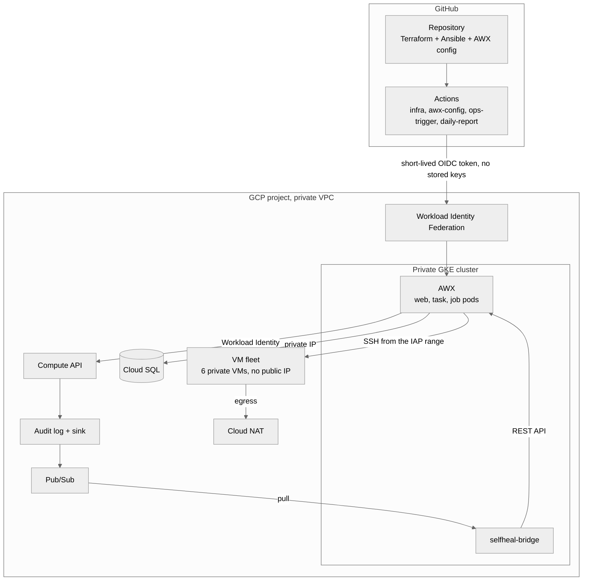
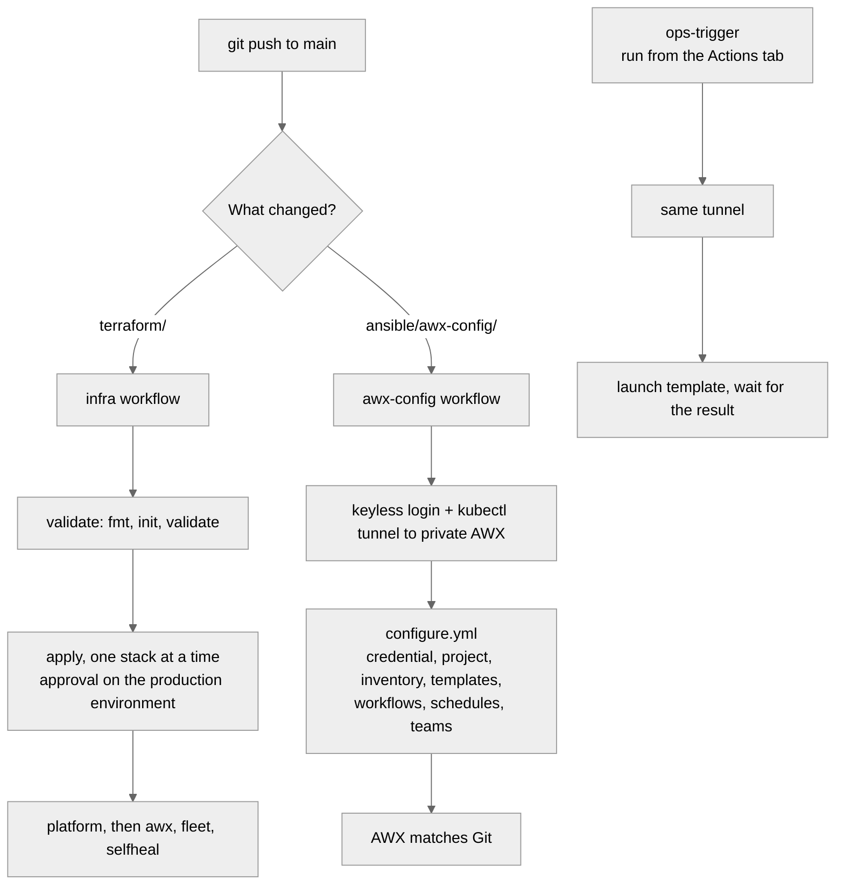
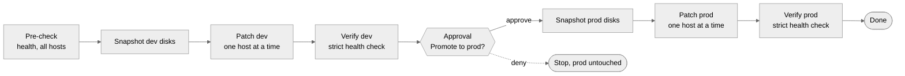
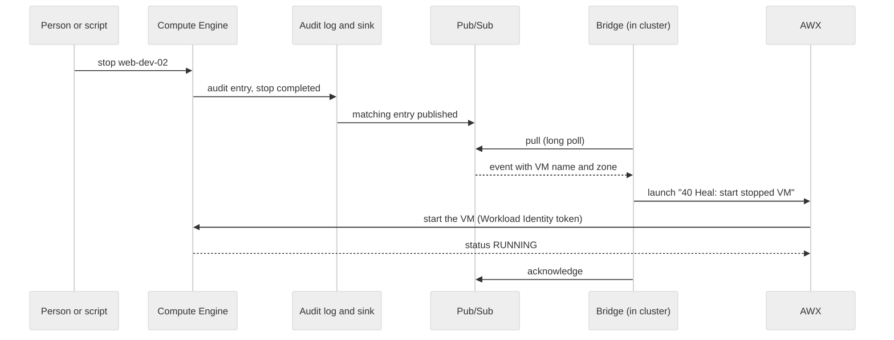
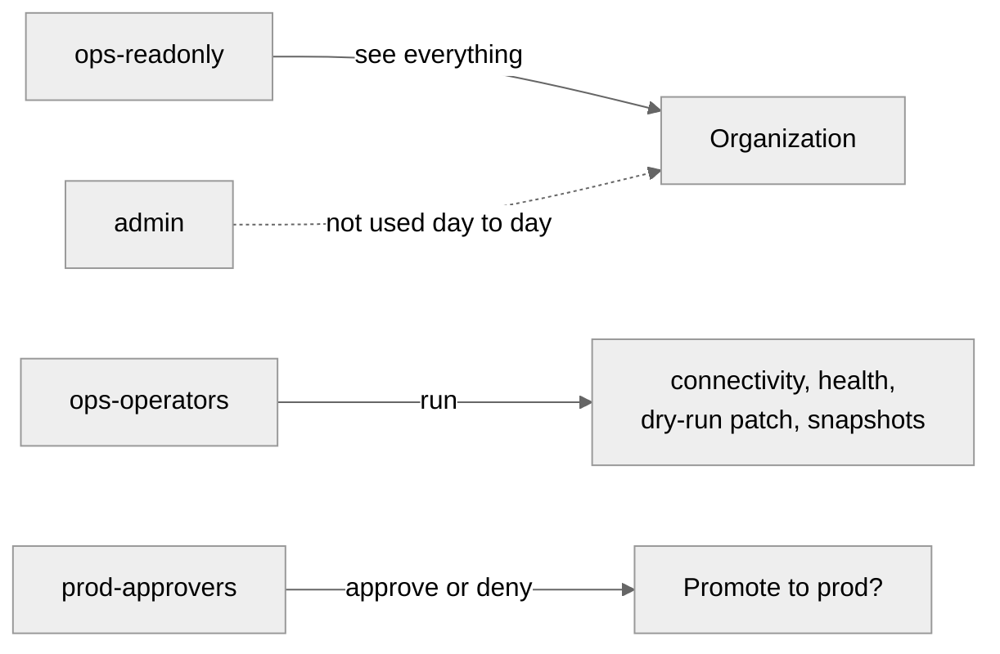

# Architecture diagrams

GitHub renders the diagrams below. PNG copies for slides and the article are in [docs/img](img).

## 1. The platform

Everything is private. AWX runs inside a private GKE cluster, reaches its database over a private IP, and manages VMs that have no public address. GitHub deploys with short-lived tokens, so there are no stored keys.

## 2. From a commit to a running system

Infrastructure and AWX configuration are separate pipelines, so changing a template never touches the cluster.

## 3. Staged patching workflow

Nothing reaches production until dev has been snapshotted, patched, verified, and a person has approved.

## 4. Self-healing

A VM is stopped. About a minute later AWX has started it again, with nobody involved.

## 5. Who can do what

