# Snapshots

Snapshots captured during the live run of the platform (project `gcp-awx-ops`, region `asia-south1`). Grouped by phase. The main [README](../README.md) shows the highlights.

Secrets in the original snapshots (an admin password, a private key, an IP address, a webhook URL) were removed or masked before publishing.

## Phase 1: Platform foundation

Folder: `docs/snapshots/01-platform/`

**Private GKE cluster awxplat-gke, healthy**

**Node pool and node status**

**AWX operator, task and web workloads running**

**Cloud SQL Postgres 15 with a private IP only**

**VPC and subnets**

**Firewall rules (IAP and internal only)**

**Workload Identity Federation pool for GitHub Actions**

**Service accounts created by Terraform**

**Terraform state bucket with a folder per stack**

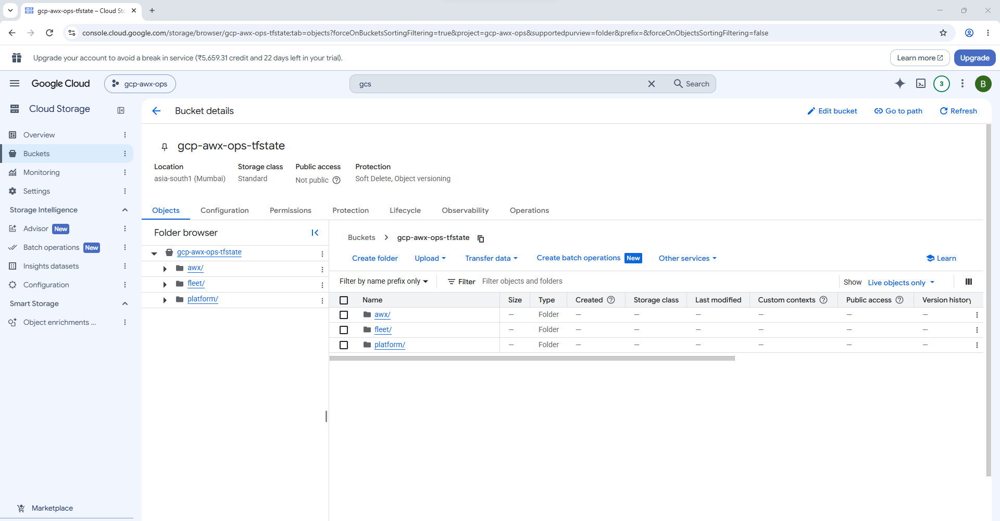

**Generated database password in Secret Manager**

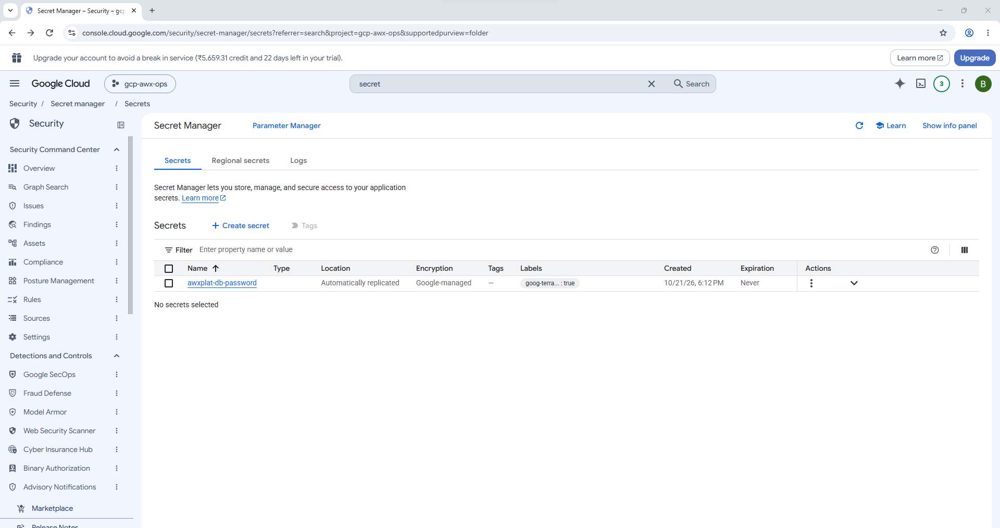

**gcloud and kubectl: cluster, nodes, pods, Cloud SQL, network**

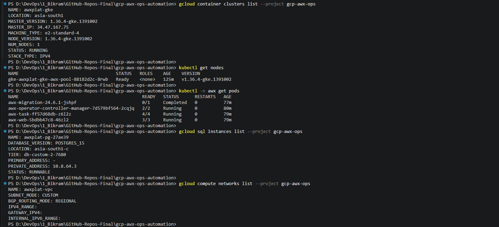

**gcloud: subnets, Cloud NAT and service accounts**

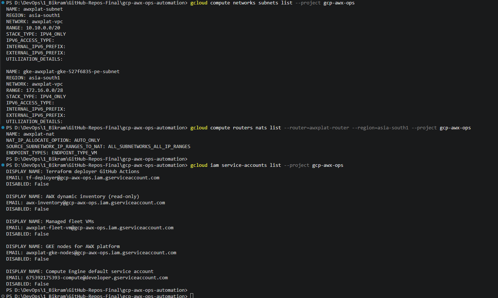

**gcloud: identity pool, secrets and state files**

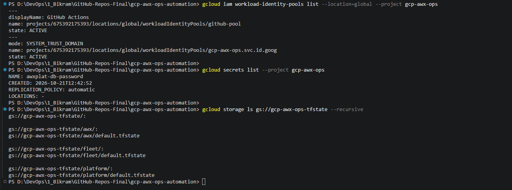

## Phase 2: AWX credential, project and inventory

Folder: `docs/snapshots/02-awx-setup/`

**First login to AWX through the port-forward**

**Machine credential fleet-ssh (key stored encrypted)**

**Project awx-ops-playbooks created from Git**

**Project sync succeeded**

**Inventory gcp-fleet**

**Dynamic inventory source from the project (gcp_compute.yml)**

**Inventory source sync succeeded**

**Inventory access**

**Groups built from VM labels (env, role, patch group)**

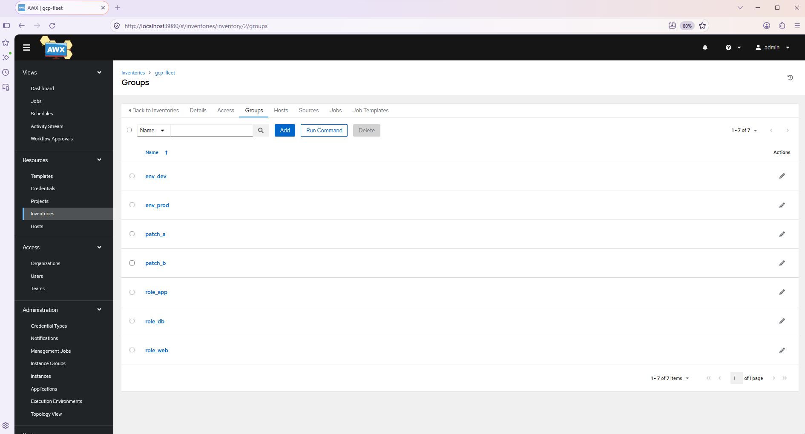

**Six imported hosts**

## Phase 2: first job templates

Folder: `docs/snapshots/03-first-playbooks/`

**Create 00 Connectivity check**

**00 Connectivity check details**

**Launch prompt with limit**

**Job output: every host answered**

**Create 10 Health check**

**10 Health check details**

**Launch prompt**

**Launch preview**

**Health report output**

**Create 20 Patch Linux (rolling)**

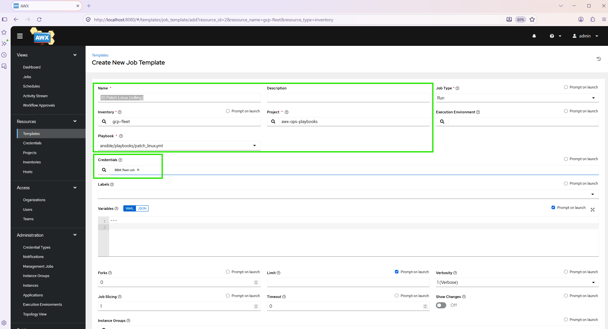

**20 Patch Linux details**

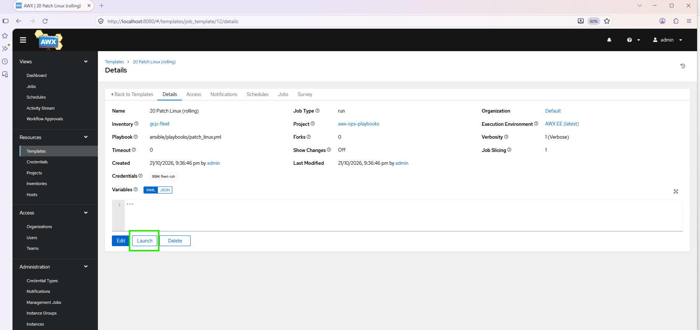

**Launch prompt**

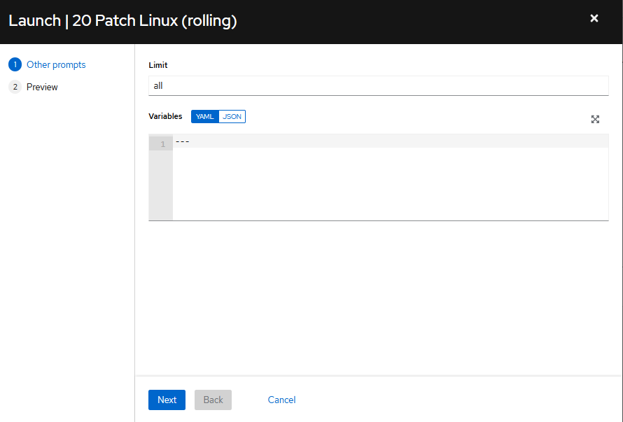

**Launch preview**

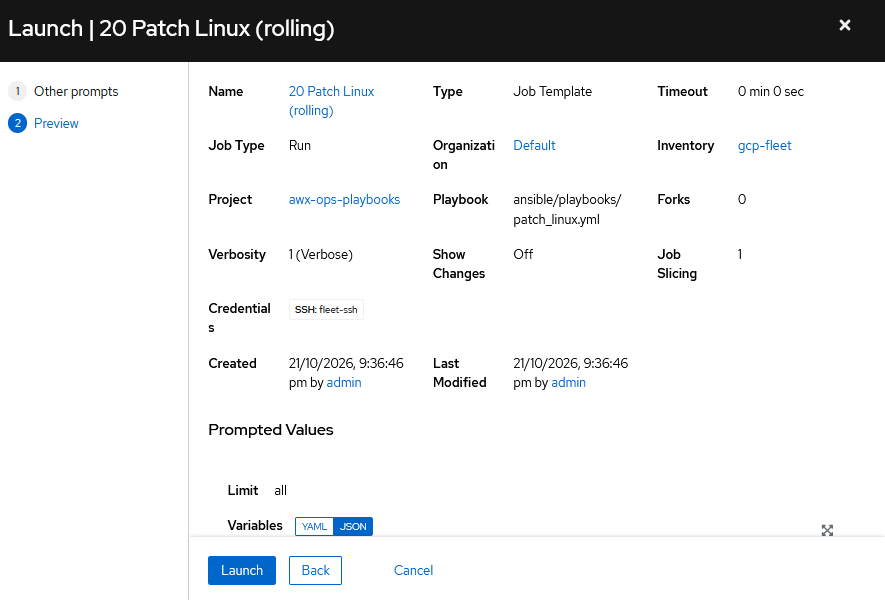

**Rolling patch with reboot and post-check**

## Phases 4 and 5: ops-trigger and the staged patching workflow

Folder: `docs/snapshots/04-ops-trigger-and-patching/`

**ops-trigger form for 10 Health check**

**ops-trigger run summary**

**ops-trigger form for 21 Patch Linux DEV (dry run)**

**Dry run summary**

**ops-trigger form for 30 Snapshot disks**

**Snapshot job summary**

**Pre-patch snapshots of the dev disks**

**Workflow 50 Staged patching**

**Workflow graph: precheck, snapshot, patch, verify, approve, prod**

**GitHub asks for production approval**

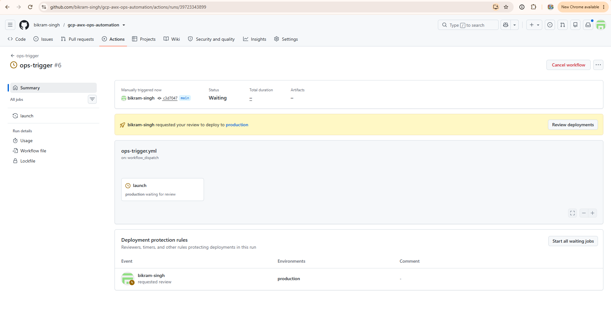

**Deployment approved**

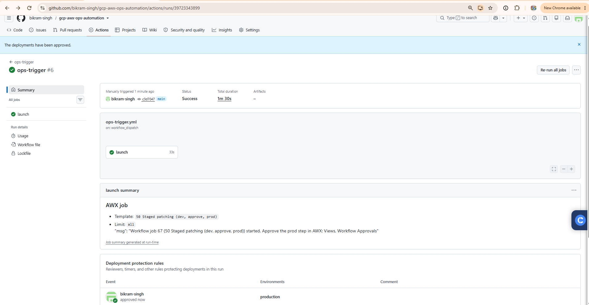

**AWX workflow approval: Promote patching to prod?**

**Workflow finished, every node green**

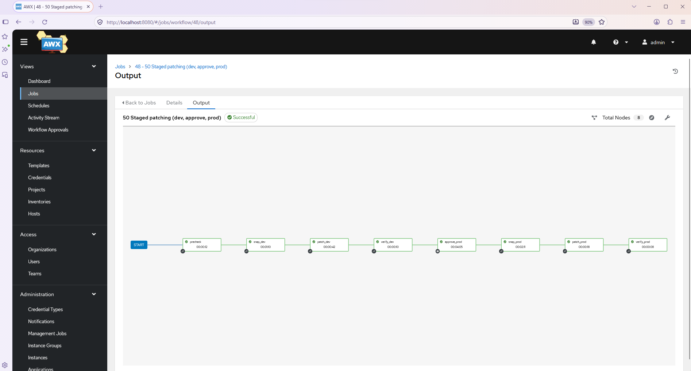

**Dev and prod snapshots taken before patching**

## Phases 6 and 8: self-healing and provisioning callback

Folder: `docs/snapshots/05-self-healing-and-onboarding/`

**infra run: IAM condition built from the fleet map**

**awx-config applied**

**Stop web-dev-02; the bridge launches the heal job**

**awx-config for Phase 8 (template 45 and bridge permissions)**

**infra run: add app-dev-02 to the fleet**

**Onboarding job started by the audit-log event**

## Phase 3a: lint, Molecule and CIS hardening

Folder: `docs/snapshots/06-hardening-and-lint/`

**ansible-lint and Molecule jobs green**

**lint workflow run, both jobs green**

**ops-trigger form for 61 Harden Linux DEV (dry run)**

**Dry run summary**

**Dry run output in check mode**

**ops-trigger form for 60 Harden Linux (dev)**

**Hardening dev run summary**

**Hardening applied to dev**

**ops-trigger form: connectivity check after hardening**

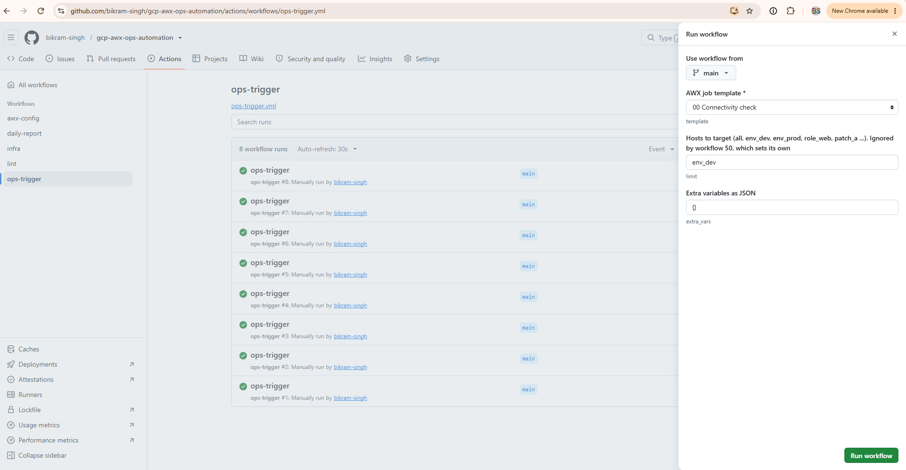

**Connectivity check summary**

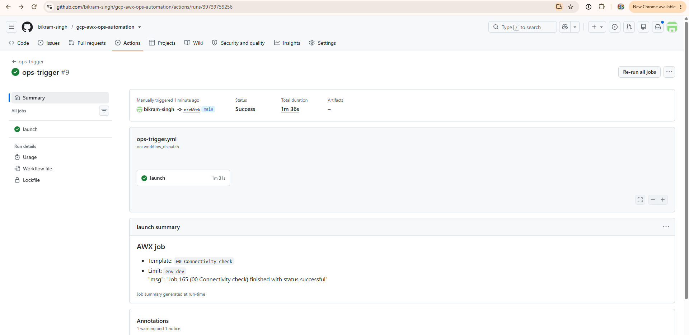

**AWX still logs in after hardening**

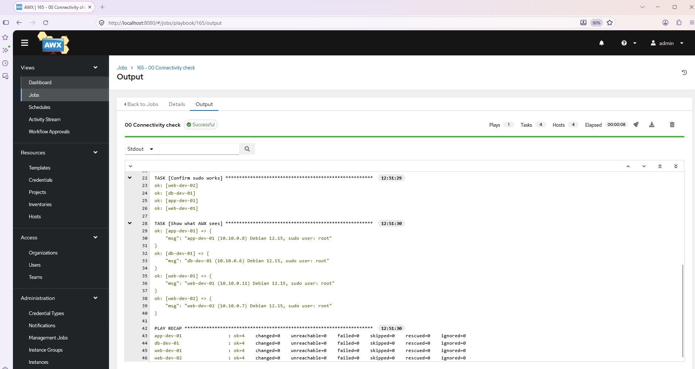

**ops-trigger form for 60 Harden Linux (prod)**

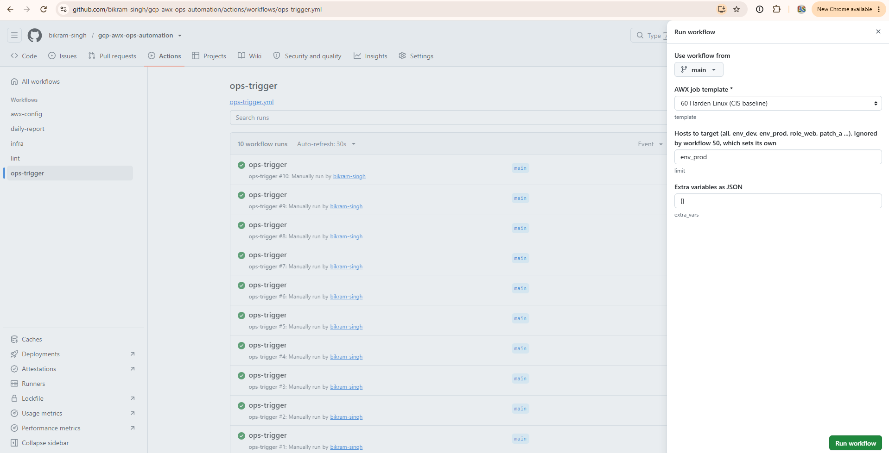

**Hardening prod run summary**

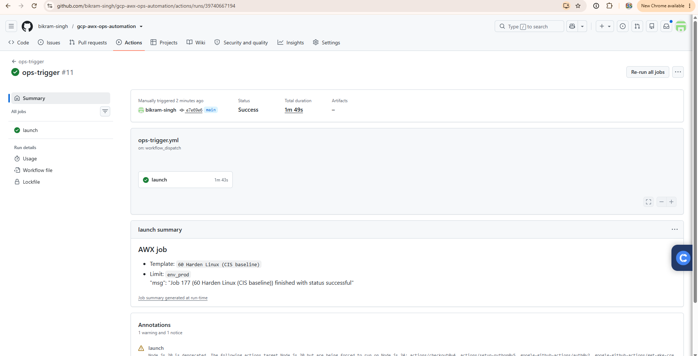

**Hardening applied to prod**

**Hardening the whole fleet, run summary**

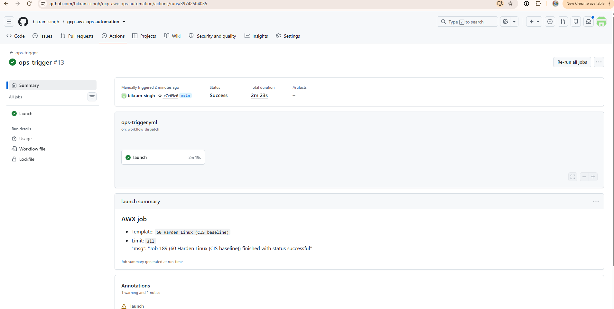

**Second run: changed=0 on every host (idempotent)**

## Phase 3b: custom execution environment

Folder: `docs/snapshots/07-execution-environment/`

**infra run: Artifact Registry**

**awx-config registers the execution environment**

**ee-build pushes the image to Artifact Registry**

**awx-config: allow a limit on template 05**

## Phase 9: optional HTTPS entry

Folder: `docs/snapshots/08-https-ingress/`

**infra run including the ingress stack**

**A record for awx at the DNS host**

**Load balancer IP and DNS lookup**

**Managed certificate: PROVISIONING, then ACTIVE**

**AWX login over HTTPS**

**AWX dashboard at https://awx.gcpcloudhub.in**

## Phase 8: notifications (7b)

Folder: `docs/snapshots/09-notifications/`

**Repository variables (AWX_DOMAIN and allow-list)**

**Notification template Ops alerts (webhook)**

**Notification template with the Test button**

**Template 45 Onboard new VM, launch**

**Discord: failed job alert**

**Job 218 succeeded (00 Connectivity check)**

**Discord: failed and succeeded alerts with real AWX links**

